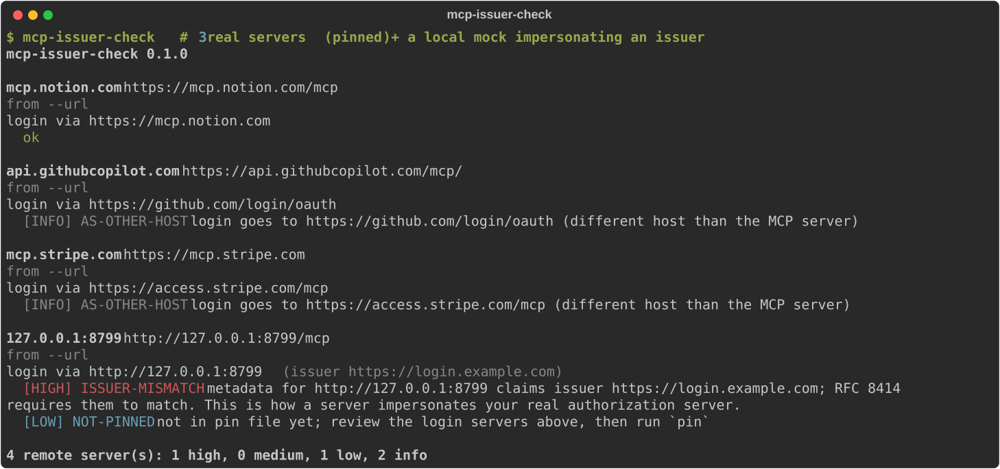

# mcp-issuer-check

**See which OAuth server your MCP servers send your login to, verify it isn't being impersonated, and get alerted if it changes.**

[](https://github.com/garag0l/mcp-issuer-check/actions/workflows/ci.yml)
[](LICENSE)


When you connect Claude, Cursor, VS Code or another client to a remote MCP server, **the server tells the client which authorization server to log you in with**. The client then sends your authorization code, PKCE verifier, client secret or refresh token there.

`mcp-issuer-check` reads your MCP client configs, finds each remote server's login server the same way a client does, and:

- **verifies the metadata**: the RFC 8414 `issuer` must match the authorization server URL, the RFC 9728 `resource` must match the server you configured, and everything must use HTTPS;
- **pins** the login servers you've approved (trust on first use) and flags any later change (`PIN-CHANGED`);
- **guards against SSRF**: it won't follow an authorization server that points at a private or internal address.

It sends no credentials and reads no secrets from your configs, only server names and URLs.



## Why this exists

In 2026 the official MCP SDKs shipped fixes for OAuth clients that **sent credentials to whichever authorization server the MCP server named** ([GHSA-6qxp-vccf-f47h](https://github.com/advisories/GHSA-6qxp-vccf-f47h), [GHSA-qx49-fqc8-xw99](https://github.com/advisories/GHSA-qx49-fqc8-xw99)). A malicious or compromised MCP server could name its own authorization server. Or it could publish no metadata and serve some that presents your real provider as the `issuer`.

The SDK fixes bind *stored* credentials to an issuer. Everything else rests on the client trusting what the server advertises the first time. The Cloud Security Alliance's [November 2026 note](https://labs.cloudsecurityalliance.org/research/csa-research-note-mcp-transport-trust-gap-20261109-csa-style/) recommends keeping an allowlist that maps each MCP server to the authorization servers it may name. No tool did that, so this one does, from your existing client configs.

## Install

```bash
pipx install git+https://github.com/garag0l/mcp-issuer-check
```

Python 3.11+, no third-party dependencies.

## Usage

```bash
mcp-issuer-check                 # discover servers in your client configs and check them
mcp-issuer-check list            # just show which remote MCP servers were found, and where
mcp-issuer-check pin             # approve the current login servers (refuses servers with bad metadata)
mcp-issuer-check --url https://mcp.example.com/mcp      # check specific servers
mcp-issuer-check --project path/to/repo                 # include .mcp.json / .cursor / .vscode configs there
mcp-issuer-check -f json         # machine-readable
mcp-issuer-check --fail-on high  # exit 1 only on high (default: medium)
```

Typical flow: run it once, review the `login via` lines, run `pin`, then run it again whenever you like (or on a schedule). A change is reported as `PIN-CHANGED`: don't sign in until the provider confirms it.

Exit codes: `0` nothing at or above `--fail-on`, `1` findings (or `pin` refused a server).

### Configs it reads

| Client | Files |
|---|---|
| Claude Code | `~/.claude.json` (user and per-project), `~/.claude/settings.json`, `.mcp.json` |
| Claude Desktop | `claude_desktop_config.json` (Windows, macOS, Linux paths) |
| Cursor | `~/.cursor/mcp.json`, `.cursor/mcp.json` |
| VS Code | user `mcp.json` and `settings.json` (JSONC), `.vscode/mcp.json` |
| Windsurf | `~/.codeium/windsurf/mcp_config.json` |
| Gemini CLI | `~/.gemini/settings.json`, `.gemini/settings.json` |
| Codex | `~/.codex/config.toml` |

Local (stdio) servers are skipped because they don't use OAuth discovery.

### Findings

| Code | Severity | Meaning |
|---|---|---|
| `ISSUER-MISMATCH` | high | Authorization server metadata claims a different `issuer` than its URL (RFC 8414 §3.3). This is the impersonation shape. |
| `PIN-CHANGED` / `ISSUER-CHANGED` | high | Login server differs from the one you pinned. |
| `INSECURE-TRANSPORT` | high | Server, metadata or endpoint over plain HTTP (allowed only on loopback). |
| `AS-PRIVATE-ADDRESS` | high | Authorization server on a private/internal address; not fetched. |
| `RESOURCE-MISMATCH` | medium | Metadata describes a different resource than the configured URL (RFC 9728 §3.3). |
| `PRM-CROSS-ORIGIN` | medium | The 401 points to resource metadata on another origin. |
| `NO-METADATA` | medium | Requires auth but publishes no RFC 9728 metadata, so clients fall back to legacy discovery. |
| `ENDPOINT-GONE` | medium | Configured URL returns 404/410. |
| `AS-NO-METADATA` | medium | No RFC 8414/OIDC metadata for a listed authorization server. |
| `ENDPOINT-OTHER-HOST` | low | Token/authorization/registration endpoint on a different host than the issuer. Usually fine; confirm it. |
| `NOT-PINNED`, `PIN-UNVERIFIED`, `UNREACHABLE` | low | Review or retry. |
| `AS-OTHER-HOST`, `NO-OAUTH` | info | Login is hosted elsewhere (common: GitHub, Stripe), or the server is public. |

### GitHub Action: alert when a provider changes its login server

```yaml
name: mcp-issuer-check
on:
  schedule: [{cron: "23 7 * * *"}]
  workflow_dispatch:
jobs:
  check:
    runs-on: ubuntu-latest
    steps:
      - uses: actions/checkout@v7
      - uses: garag0l/mcp-issuer-check@v0.1.0
        with:
          urls: |
            https://mcp.notion.com/mcp
            https://api.githubcopilot.com/mcp/
          pins: .github/mcp-pins.json   # create with: mcp-issuer-check pin --url ... --pins .github/mcp-pins.json
          fail-on: high
```

### TLS errors

If a server works in your browser but shows `TLS verification failed`, your Python CA store is probably missing a root. Some Windows setups lack the newer Let's Encrypt roots, for example. Use `--ca-bundle /path/to/cacert.pem` (e.g. from `certifi`) or set `SSL_CERT_FILE`. Verification is never turned off.

## How it discovers (same order as the MCP spec)

1. Unauthenticated `initialize` POST, read `WWW-Authenticate: Bearer resource_metadata="…"`.
2. RFC 9728 metadata: the URL from step 1, then `/.well-known/oauth-protected-resource/<path>`, then the root.
3. For each `authorization_servers` entry: RFC 8414 `/.well-known/oauth-authorization-server/<path>`, then the OpenID Connect variants.

Redirects are not followed. Responses are capped at 512 KB.

Tested against 20 public MCP server endpoints from 19 providers (Notion, Linear, Sentry, GitHub, Atlassian, Stripe, Asana, Cloudflare, PayPal, Square, Intercom, Vercel, Supabase, Hugging Face, Context7, DeepWiki, monday.com, HubSpot, Webflow) and a mock server covering every finding.

## Scope and responsible use

This is a defensive tool for checking the MCP servers *you* use or are authorized to assess. It only fetches public discovery metadata, the same requests any MCP client makes before you sign in.

## Contributing

Issues and PRs are welcome, especially config locations for more clients, and real-world metadata quirks (with the server URL).

```bash
python -m venv .venv && . .venv/bin/activate
pip install -e ".[dev]"
pytest && ruff check . && ruff format --check .
```

## License

[MIT](LICENSE)
